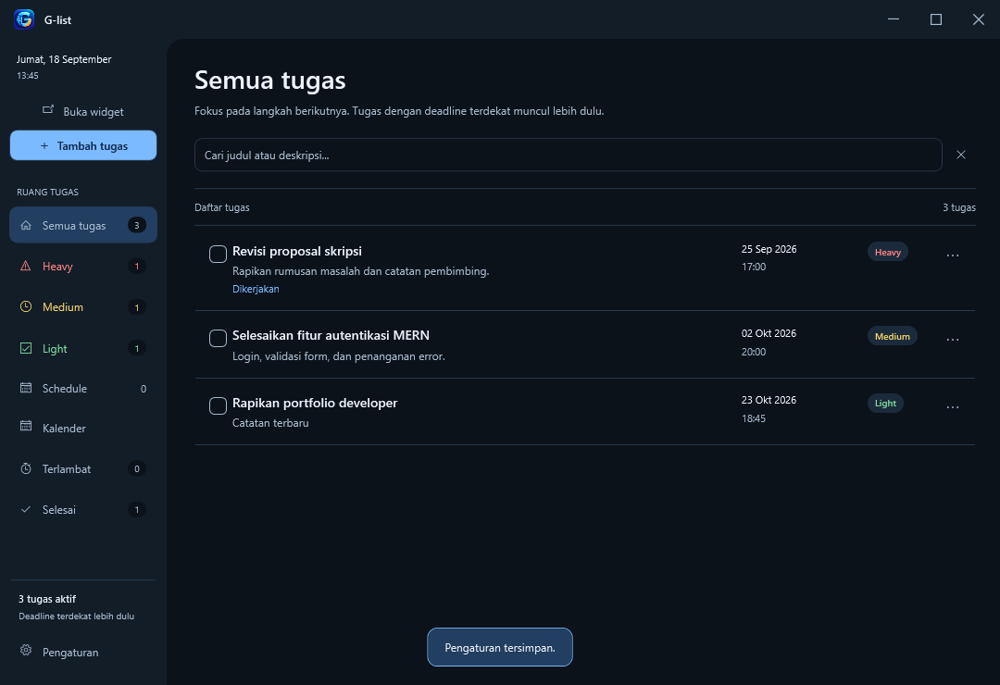
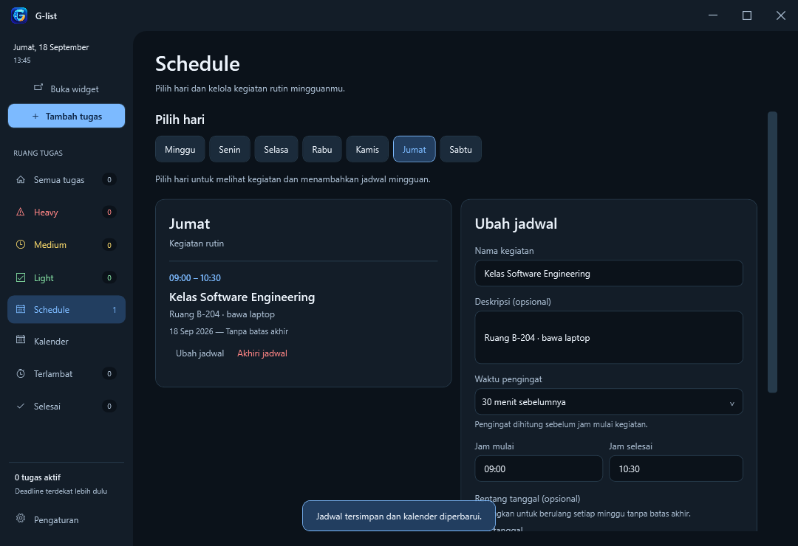
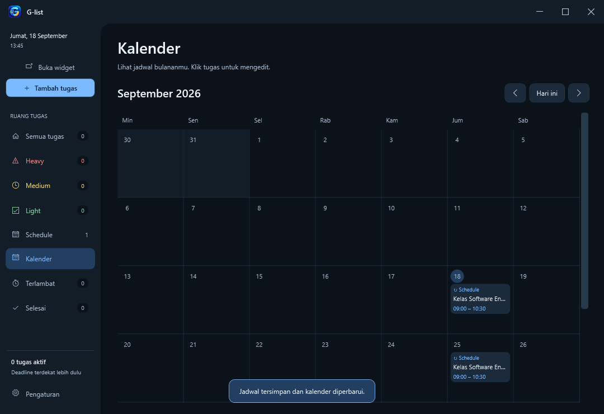
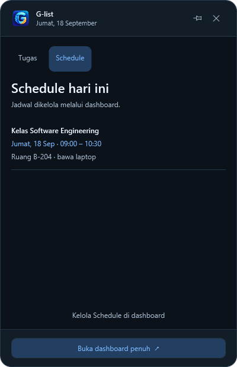

# G-list

**Aplikasi desktop Windows untuk mengelola tugas, jadwal mingguan, dan pengingat dalam satu tempat.**

G-list menyediakan dashboard untuk pengelolaan lengkap serta widget untuk melihat tugas dan jadwal hari ini. Data tersimpan lokal tanpa akun atau server.



## Tentang proyek

Proyek ini berangkat dari kebutuhan mengatur tugas kuliah, pekerjaan, dan kegiatan rutin melalui aplikasi desktop. Fokus implementasinya adalah antarmuka yang konsisten, penyimpanan lokal, kategori tenggat otomatis, serta pengingat mingguan yang tidak dikirim ulang setelah aplikasi direstart.

Versi source: **1.4.1**. Pengembangan dilakukan dengan bantuan AI untuk implementasi, debugging, dan pengujian. Repository ini menyertakan source dan pengujian agar perilaku aplikasi dapat dipelajari serta diverifikasi.

## Fitur

- **Manajemen tugas:** tambah, edit, deskripsi, deadline tanggal dan jam, mulai mengerjakan, selesai, dan buka kembali.
- **Kategori tenggat:** Heavy hingga 7 hari, Medium 8–14 hari, Light lebih dari 14 hari. Kategori otomatis mengikuti tanggal lokal; pilihan manual tersedia melalui konfirmasi. Tugas terlambat memiliki filter tersendiri.
- **Dashboard:** pencarian judul/deskripsi, filter, jumlah tugas di sidebar, dan konfirmasi tindakan di dalam aplikasi.
- **Schedule mingguan:** pilih hari, nama kegiatan, deskripsi opsional, jam mulai/selesai, pengingat, serta rentang tanggal opsional.
- **Kalender:** tugas dan pertemuan mingguan ditampilkan pada tanggalnya. Minggu menjadi hari pertama.
- **Widget:** daftar tugas serta Schedule khusus hari ini, dengan opsi selalu di atas jendela lain. Schedule dikelola melalui dashboard.
- **Reminder:** popup dan suara; pengingat task mendukung snooze. Schedule mendukung saat mulai, 15/30/60 menit sebelumnya, atau tanpa pengingat.
- **Arsip Schedule:** mengakhiri jadwal menghentikan reminder dan memindahkannya ke Selesai tanpa menghapus data.
- **Pengaturan:** bahasa Indonesia/Inggris, suara, volume, startup Windows, backup dan restore database.

### Schedule dan kalender







Screenshot berasal dari pengujian menggunakan data contoh, bukan database pribadi.

## Tech stack

| Bagian | Teknologi |
| --- | --- |
| Bahasa dan runtime | C#, .NET 8 |
| UI desktop | WPF, XAML |
| Struktur aplikasi | MVVM (Model–View–ViewModel) |
| Database lokal | SQLite melalui Microsoft.Data.Sqlite 8.0.4 |
| System tray | Windows Forms NotifyIcon |
| Pengujian | Harness C# khusus dengan pengujian fungsi dan render WPF |
| Installer | Inno Setup 6, Windows x64 |

## Menjalankan aplikasi

### Prasyarat

- Windows 10/11.
- .NET 8 SDK.
- Opsional: Visual Studio 2022 dengan workload **.NET desktop development**.
- Inno Setup 6 hanya diperlukan untuk membuat installer.

Jalankan perintah berikut dari root repository:

```powershell
dotnet restore TodoApp/TodoApp.csproj
dotnet run --project TodoApp/TodoApp.csproj
```

Untuk mencoba dengan database terpisah dan reminder dinonaktifkan:

```powershell
dotnet run --project TodoApp/TodoApp.csproj -- --data-dir .\local-data\demo --no-reminders
```

Menutup widget tidak selalu menghentikan aplikasi. Gunakan **Keluar G-list** pada ikon system tray untuk keluar sepenuhnya.

## Menjalankan pengujian

```powershell
dotnet build Tests/GTools.SmokeTests/GTools.SmokeTests.csproj
dotnet Tests/GTools.SmokeTests/bin/Debug/net8.0-windows/GTools.SmokeTests.dll .audit/smoke-results
```

Pengujian membutuhkan sesi desktop Windows karena membuka jendela WPF sementara. Harness menggunakan database terpisah dan menonaktifkan startup produksi. Hasilnya mencakup `result.txt`, log binding, dan screenshot di `.audit/smoke-results`.

Cakupan meliputi batas kategori tanggal, penyimpanan dan restore, reminder/snooze, pengulangan mingguan, arsip Schedule, pemilihan dropdown saat tambah/edit, pergantian bahasa, kalender, serta layout responsif. Pengujian pemutar suara tidak membuktikan bahwa audio benar-benar terdengar pada perangkat pengguna.

## Membuat aplikasi dan installer

Publish self-contained menyertakan runtime sehingga pengguna tidak perlu memasang .NET secara terpisah:

```powershell
dotnet publish TodoApp/TodoApp.csproj -c Release -r win-x64 --self-contained true -o artifacts/gtools-win-x64 -p:DebugType=None -p:DebugSymbols=false
```

Kemudian jalankan compiler Inno Setup dari root repository. Jika `ISCC.exe` sudah tersedia di PATH:

```powershell
ISCC.exe setup.iss
```

Hasilnya adalah `todolist new.exe`, dengan nama aplikasi terpasang **G-list**. Installer dan output build tidak dilacak Git. Untuk distribusi di GitHub, unggah installer melalui **Releases**.

## Struktur repository

```text
TodoApp/
  Models/       Data task, Schedule, pengaturan, dan entri kalender
  ViewModels/   State UI, validasi, dan perintah pengguna
  Views/        Jendela dan komponen XAML
  Services/     SQLite, reminder, bahasa, suara, dan startup
  Assets/       Ikon, logo, dan placeholder audio
Tests/
  GTools.SmokeTests/  Pengujian fungsi dan render UI
docs/images/    Screenshot dengan data contoh
setup.iss       Konfigurasi installer
```

### Alur utama

```text
View (XAML) → ViewModel → DatabaseService → SQLite
                    ↘ ReminderService → popup dan suara
```

ViewModel memperbarui daftar dan kalender setelah perubahan data. Reminder Schedule dicatat per seri, revisi, dan waktu pertemuan agar tidak dikirim ulang setelah restart. Mengedit seri menghasilkan revisi baru.

## Penyimpanan dan kompatibilitas

Database produksi berada di `%LocalAppData%\G-tools\todo.db`. Nama folder lama **G-tools** sengaja dipertahankan agar upgrade ke G-list tetap menggunakan data yang sama. Nama proyek `TodoApp` dan `GTools.SmokeTests` juga merupakan identitas internal yang masih dipertahankan.

Database, draft pribadi, hasil pengujian, dan backup tidak disertakan dalam repository.

## Batasan saat ini

- Hanya mendukung Windows; belum ada sinkronisasi cloud atau versi mobile.
- Reminder memerlukan aplikasi berjalan, termasuk di tray. Kegiatan Schedule yang sudah berakhir tidak menghasilkan reminder terlambat.
- Jam mulai dan selesai Schedule harus pada hari yang sama.
- Edit Schedule berlaku pada seluruh seri, termasuk tampilan historis di kalender. Untuk mempertahankan jadwal semester lama, akhiri seri lama lalu buat seri baru.
- `default_alarm.mp3` saat ini merupakan placeholder kosong dari source aplikasi. Pilih MP3 sendiri melalui Pengaturan untuk suara kustom; reminder memiliki fallback suara sistem jika pemutaran gagal. Lagu pribadi tidak dibundel.

## Lisensi

Repository ini belum menetapkan lisensi distribusi. Menampilkan source di GitHub tidak otomatis memberikan izin penggunaan ulang. Lisensi dapat ditambahkan oleh pemilik proyek setelah menentukan ketentuan source dan aset yang ingin dibagikan.
